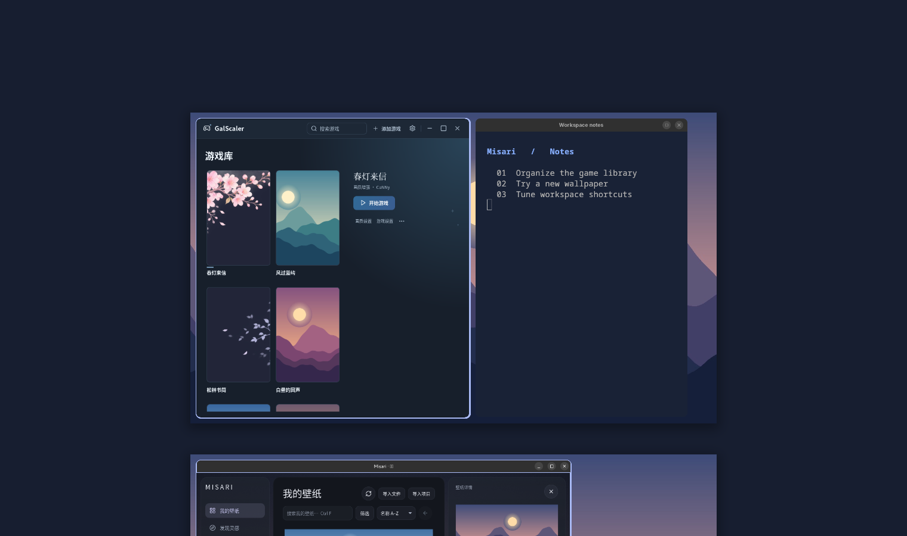
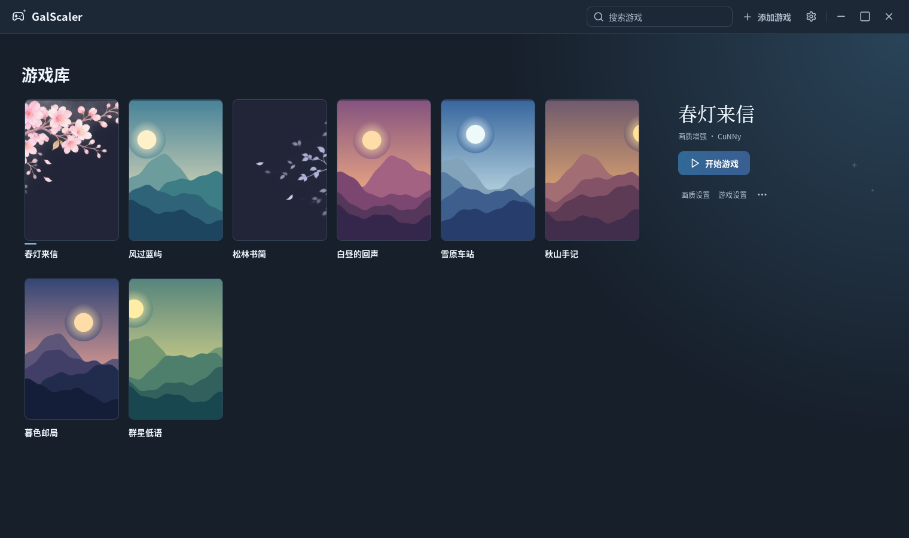

# Misari

Misari 是个人维护的 Linux 桌面项目，基于 niri：窗口横向排列，可以左右滚动浏览。项目加入了窗口召回、跟随、置顶和动态壁纸等功能。你可以用快捷键找到应用、把窗口带到当前桌面，也可以通过壁纸面板管理和播放壁纸。

名称取自《欢迎加入 NHK》的中原岬（Misaki）与 niri。

## 桌面由哪些部分组成

| 组件 | 能做什么 |
| --- | --- |
| [niri](niri/docs/README.md)（fork 版） | 排列窗口，在不同工作区之间切换。 |
| [wallpaperd](tools/wallpaperd/README.md) | 在后台播放壁纸，记住每块屏幕的选择和播放设置。 |
| [GalScaler](tools/galscaler/README.md) | 管理和启动 Windows Galgame，增强游戏画面，也可以串流到手机。 |

## niri 新增功能

- [查找与切换窗口](docs/feat/window-selection.md)：按应用或标题找到窗口，并切换过去。
- [切换或打开应用](docs/feat/window-focus-or-spawn.md)：应用已有窗口时切换过去，没有时打开应用。
- [暂存与召回窗口](docs/feat/window-stash-recall.md)：把暂时不用的窗口放到专用工作区，需要时带到当前工作区；也可以在应用未打开时启动它。
- [窗口跟随](docs/feat/window-follow.md)：切换工作区后，让指定窗口跟过来，适合视频或聊天窗口。
- [窗口置顶](docs/feat/window-pinned.md)：让浮动窗口显示在其他窗口上方，包括全屏应用。
- [指定窗口截图](docs/feat/window-screenshot.md)：截取指定窗口，无需先切换过去；也支持不弹通知、不改剪贴板的截图方式。
- [屏幕边缘滚动](docs/feat/edge-scroll.md)：在屏幕边缘滚动鼠标或触摸板，切换工作区，或配合 Noctalia 调整音量、亮度。
- **单独按键触发操作**：单独短按或长按 Super 等按键可以执行不同操作，仍可将它用于组合快捷键。
- **最近窗口切换**：快速切换最近使用的窗口，也可只切换当前工作区或同一应用的窗口。
- **Agent 桌面操作**支持在后台和锁屏时对指定窗口截图、点击、滚动和输入中文。用 `niri msg agent` 按截图坐标操作并获取回执，用 `niri-agent-ui` 查找控件。你可以点击 Agent 启动的窗口临时接管，切走后你和 Agent 各自保留剪贴板内容。
- **远程桌面**支持 Mutter 兼容接口。搭配 UU 远程的 Linux 被控端，可通过 UU 远程连接并操作 Misari 桌面。实现移植自 [niri PR #1966](https://github.com/niri-wm/niri/pull/1966)。

窗口管理功能的快捷键和窗口规则示例见 [example.kdl](configs/example.kdl)。

## 壁纸能做什么

- **播放静态和动态壁纸**：支持图片、视频、GIF、着色器动画，以及 Wallpaper Engine 的场景、视频和网页壁纸。网页壁纸需要额外安装运行库，见 [安装说明](tools/wallpaperd/README.md#启用-web-壁纸可选)。
- **分别设置每块屏幕**：为不同屏幕选择壁纸，调整裁切、缩放、音量和帧率上限；切换时可使用过渡动画，重新连接屏幕后恢复已保存的设置。
- **整理与自动换壁纸**：导入本地素材，发现已下载的 Steam 创意工坊壁纸，收藏喜欢的壁纸，并按列表顺序或随机轮播。
- **自动暂停与静音**：锁屏、休眠或使用全屏窗口时暂停；其他应用发声时静音壁纸，结束后自动恢复。
- **与壁纸互动**：支持鼠标互动、随声音变化的效果，以及壁纸作者提供的颜色、文字等设置；支持的壁纸还可以显示正在播放的歌曲信息。
- **同步桌面背景**：多屏播放同一视频或场景壁纸时同步进度，也可将壁纸画面用于工作区概览和锁屏背景。

播放设置和命令行用法见 [wallpaperd 文档](tools/wallpaperd/README.md)。

## GalScaler 能做什么

- **整理游戏库**，扫描游戏目录或手动选择 `.exe`，为游戏添加本地或 VNDB 封面，用封面网格或列表浏览。
- **启动游戏并增强画质**，通过 umu 和 Proton 运行 Windows Galgame，按游戏设置兼容环境、增强算法、分辨率和帧率。
- **在手机上玩**，用浏览器或 Android 客户端连接同一局域网内的电脑，串流游戏画面和声音。轻点推进剧情，长按打开右键菜单。

导入游戏和调整画质见 [游戏库与画质增强](tools/galscaler/docs/game-library.md)。开启服务和连接手机见 [局域网串流](tools/galscaler/docs/lan-streaming.md)。

## 开始使用

Misari 安装包提供的命令仍叫 `niri`，安装时会与官方 `niri` 包冲突。如果已经使用 niri，安装前请留意这一点。

1. 按 [niri 安装与配置说明](niri/docs/README.md) 准备桌面。个人配置放在 `~/.config/niri/config.kdl`；可从 [默认配置](niri/resources/default-config.kdl) 开始，再按需加入上面的功能示例。
2. 如果需要动态壁纸，按 [wallpaperd 安装说明](tools/wallpaperd/README.md#快速上手) 安装并启动壁纸服务。
3. 如果想运行 Windows Galgame，按 [GalScaler 构建与启动说明](tools/galscaler/README.md#构建与启动) 准备运行环境并打开游戏库。

保存 niri 配置后会自动生效。修改后可在终端运行 `niri validate` 检查配置是否有误。

## 许可证

MIT

## 致谢

- Misari 的窗口管理基于 [niri](https://github.com/niri-wm/niri)。
- 项目早期集成了提供窗口切换和跟随等功能的 [nirius](https://sr.ht/~tsdh/nirius/)。
- Agent 桌面操作移植自 [shorin-niri](https://github.com/SHORiN-KiWATA/shorin-niri)。
- wallpaperd 的 Wallpaper Engine 兼容性测试以 [we-layerd](https://github.com/Aromatic05/we-layerd) 等项目作为对照。
- 感谢为 Wayland 合成器和客户端提供基础库的 [Smithay](https://github.com/Smithay/smithay)、[wayland-rs](https://github.com/Smithay/wayland-rs) 和 [Smithay Client Toolkit](https://github.com/Smithay/client-toolkit)。
