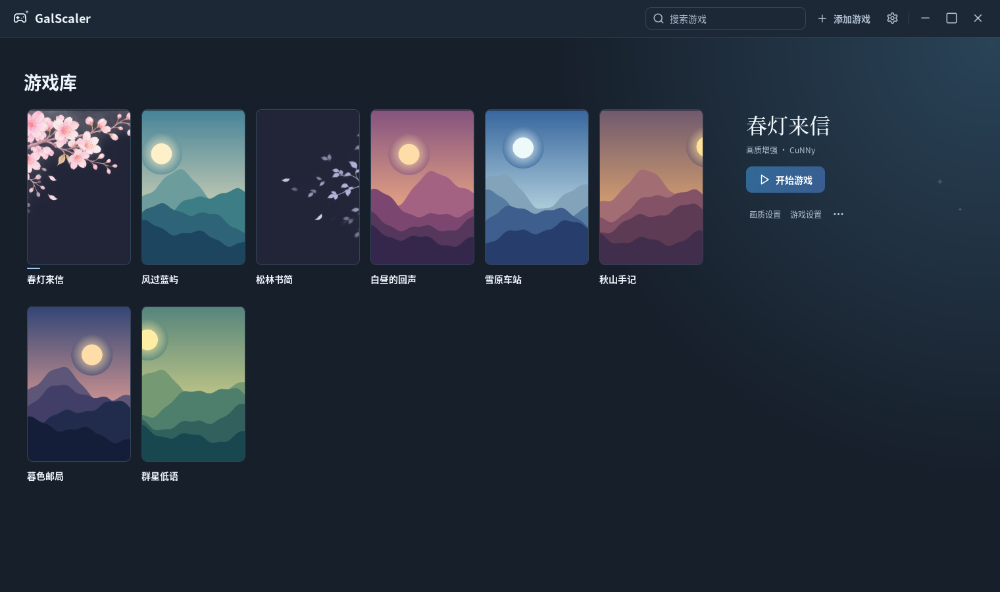

# GalScaler 游戏库与画质增强

在 Wayland 桌面上导入和启动 Windows Galgame。首次使用时，先按 [构建与启动说明](../README.md#构建与启动) 准备运行环境。

## 添加和启动游戏



1. 在工具栏点击「添加游戏」，选择游戏目录。GalScaler 会扫描常见视觉小说引擎的资源和启动文件，只有一个候选时会自动选中。也可以手动选择要运行的 `.exe`。
2. 选定启动文件后点击「添加到游戏库」。名称默认使用游戏目录名。
3. 在游戏库选中游戏，点击「开始游戏」。在「游戏设置」里可以修改名称、选择本地封面，或在 VNDB 查找封面。

游戏库可以按名称搜索，也可以在封面网格和列表之间切换。关闭 GalScaler 窗口后，后台服务和游戏会继续运行。结束游戏后可将它移出游戏库，游戏文件和 Wine 环境会保留。

## Proton 和兼容环境

在「全局设置」的「游戏启动」里选择默认 Proton 和画质。在单个游戏的「游戏设置」中打开「启动与画面」，可以覆盖全局选项，也可以设置该游戏的启动参数。

- **共享环境**是新游戏的默认设置。首次启动时会绑定 Proton 版本，同一时间只能运行一个使用该环境的游戏。
- **独立环境**为该游戏单独保存 Wine 环境，适合需要其他 Proton 版本或单独存档的游戏。切换环境后，已有存档仍保留在原环境。

## 画质增强

选中游戏后打开「画质设置」。默认使用 CuNNy，以 1280×720 的游戏分辨率运行，增强分辨率上限为 2560×1440，帧率设置为 60。

- **增强算法**有 CuNNy、Anime4K 和无滤镜，对应 CLI 的 `cunny`、`anime4k` 和 `linear`。无滤镜使用基础缩放。关闭画质增强后，桌面端直接通过 umu 和 Proton 启动游戏。
- **游戏分辨率**是游戏看到的虚拟屏幕尺寸，对应 `source`。**输出分辨率**是增强处理的尺寸上限，对应 `output`。画面按游戏内容的宽高比缩放。
- 本地增强窗口可用 F11 切换全屏。窗口大小变化时，增强处理尺寸保持不变。

画质设置在下次启动游戏时生效。

## 命令行

在 `tools/galscaler` 完成 release 构建后，可用 CLI 添加和启动游戏。将示例中的 `id` 改为 `add` 返回的游戏 ID。

```sh
./target/release/galscaler add "/path/to/game.exe" --name "游戏名称"
id=1
./target/release/galscaler edit "$id" --prefix independent --filter anime4k
./target/release/galscaler launch "$id"
./target/release/galscaler status
./target/release/galscaler log "$id" --lines 100
```

`edit --arguments` 用 JSON 数组替换启动参数，`edit --environment` 用 JSON 对象替换环境变量。传入 `[]` 可清空启动参数，传入 `{}` 可让该游戏使用空的环境变量覆盖项。

`stop <id>` 结束单个会话，`shutdown` 结束全部会话并关闭后端。`remove <id>` 将已停止的游戏移出游戏库。其他命令见 `galscaler --help`。
